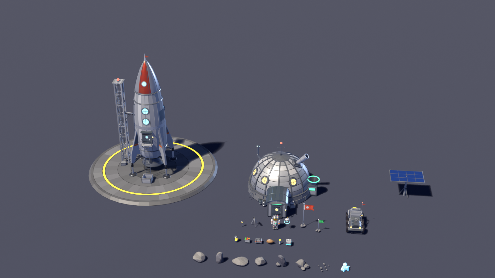

# Astro Outpost — 3D asset pack

Metal look: brushed and painted steel panels in light-to-mid greys, gunmetal frames, chrome rivets, with a
few small accents (red flag and nose stripes, a safety-orange stripe, the gold visor, warm and cool lights).
All designs are original; the two reference images were used for mood only.



## In the game

The models are already used by the game. `assets/blender/scripts/export_js.py` packs them into
`js/models-data.js`, and `js/models.js` turns that back into three.js objects. Like the team's `js/assets.js`, this
needs no extra downloads and also works when `index.html` is opened straight from disk.

| Model | Replaces (in code) | Notes |
| --- | --- | --- |
| habitat | dome, airlock, windows, beacon, pantry hatch in `hab()` (`js/base.js`) | the soil bags, door light colours and beacon pulse are still driven by the game |
| flag | habitat flag | the cloth swings on Mars like before |
| flag_marker | flag planted at finished science sites | |
| rocket | rocket, launch pad, gantry in `rocket()` | the ship lifts off and is the lander in the landing film; flame and engine light unchanged |
| solar_panel | the three tracking panels in `solar()` | panels still follow the Sun; dust still tints the glass on Mars |
| path_lantern | the six path lights | |
| telescope | — (new) | stands beside the airlock, with a collider |
| astronaut | `buildAstronaut()` (`js/actors.js`) | same shoulder and hip pivots; the cuffs take the suit colour chosen at setup |
| buddy | `buildBuddy()` | |
| rover | `buildRover()` | wheels spin and steer, the charging ring changes colour as before |
| power_cell, soil_bag, core_sample, food_crate, instrument, supply_case | carried items in `itemMesh()` | soil bag coloured per site, core cap per quality, instrument band per instrument |

The team's Blender rocks, mountains and ground in `js/assets.js` were kept, so `rocks.glb` is not used in the game.
If `js/models-data.js` is missing, `JA.models.has()` returns false and the game draws its original shapes.

## What is here

| Path | Contents |
| --- | --- |
| `../js/models-data.js` | The models packed for the game (1.9 MB). Generated: do not edit by hand. |
| `../js/models.js` | Decoder: `JA.models.make(name)` returns a fresh copy; `JA.models.mat(copy, name)` finds a material to recolour. |
| `models/` | 17 `.glb` files (glTF 2.0, 4 MB, about 54,500 triangles) for other tools and engines. |
| `previews/` | Rendered pictures of every model. |
| `blender/astro_outpost_assets.blend` | The Blender 5.3 scene with every model, one collection per asset. |
| `blender/scripts/` | The Python scripts that build everything. The `.blend`, the `.glb` files and `js/models-data.js` are all generated from these. |
| `viewer.html` | A three.js page (same r149 release as the game) to look at the `.glb` files. |

## Models

| File | Triangles | Named parts |
| --- | ---: | --- |
| `rocket.glb` | 16,000 | `rocket_ship` (lifts off), `rocket_pad`, `rocket_gantry`, `rocket_towerLight` |
| `habitat.glb` | 12,576 | `hab_main`, `hab_doorLight` (material `Glow_Door`), `hab_beacon` |
| `astronaut.glb` | 7,174 | `astro_body`, `astro_armL/R`, `astro_legL/R` (pivots at shoulder and hip), `astro_antennaTip`, `astro_drill`, `astro_drillBit` |
| `rover.glb` | 7,258 | `rover_body`, `rover_wheel_0`…`5` (spin about x), `rover_socketRing` (material `Glow_Socket`) |
| `buddy.glb` | 2,210 | `buddy_body`, `buddy_eyeL/R`, `buddy_ring` |
| `flag.glb`, `flag_marker.glb` | 1,772 / 1,380 | `flag_pole` + `flag_cloth`, `marker_pole` + `marker_cloth` (cloth hinged on the pole) |
| `rocks.glb` | 1,474 | `Rock_A`…`Rock_F`, `Pebbles`, `IceCrystals` (not used in the game, see above) |
| `solar_panel.glb` | 768 | `solar_post`, `solar_panel` (pivot at y = 3.8) |
| `telescope.glb`, `path_lantern.glb` | 844 / 390 | single piece |
| `power_cell.glb`, `food_crate.glb`, `supply_case.glb`, `soil_bag.glb`, `core_sample.glb`, `instrument.glb` | 250–640 each | carried items, centred on their origin; `core_cap` (`Glow_Core`) and `instrument_band` (`Glow_Inst`) are separate so the game can colour them |

Conventions:

- 1 unit = 1 metre, +Y up, the front of each model faces +Z, the same as the game.
- Colour is stored per vertex (no textures). Materials: `Paint` (painted metal), `Metal` (bare steel), `Cloth` (fabric, rubber, food).
- Tintable materials (the game sets `material.color`): `SuitAccent` (suit colour), `Suit` (suit fabric), `Rock`, `Sack` (soil bag), `SolarGlass` (dust).
- Glowing parts use materials named `Glow_*`, `Visor` and `Ice`.
- A part with several materials becomes a small group named after the part (for example `astro_body`) with one mesh per material.
- In the game, model materials get a small reflection map made from the site's sky and ground colours, so the metal reads as metal.

## Rebuilding

From the repository root:

```
blender -b --factory-startup --python-exit-code 1 --python assets/blender/scripts/build_all.py
blender -b assets/blender/astro_outpost_assets.blend --python-exit-code 1 --python assets/blender/scripts/render_previews.py
```

The first command rebuilds every model, exports `models/*.glb`, saves the `.blend` and rewrites `js/models-data.js`;
the second re-renders `previews/`. To change a model or its colours, edit its `build_*.py` script (the shared palette is
at the top of `kit.py`) and run the first command again. The scripts refuse to run inside any other `.blend`.

## Looking at the models

From the repository root run `python -m http.server 8765`, then open `http://127.0.0.1:8765/` for the game or
`http://127.0.0.1:8765/assets/viewer.html` for the `.glb` viewer.
